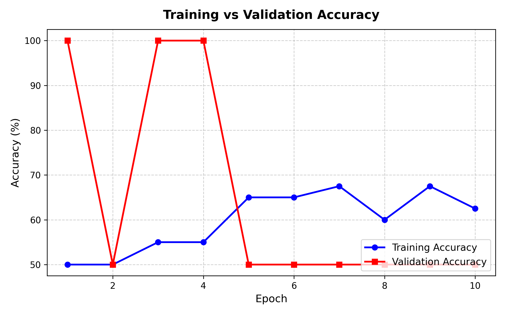
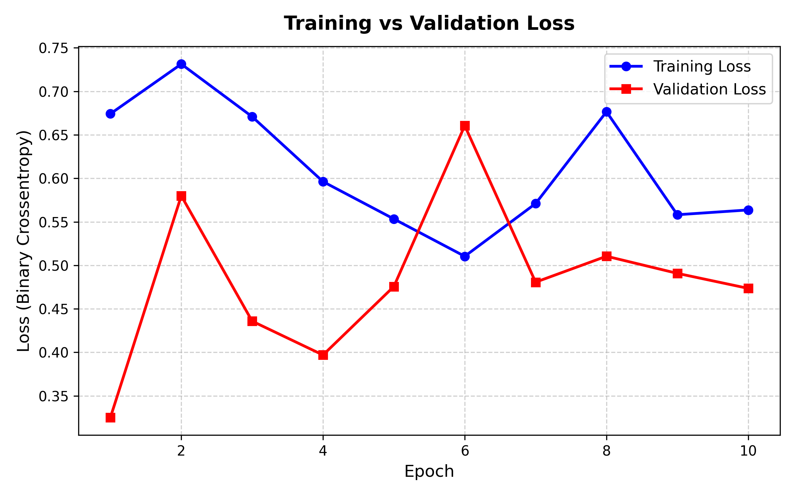
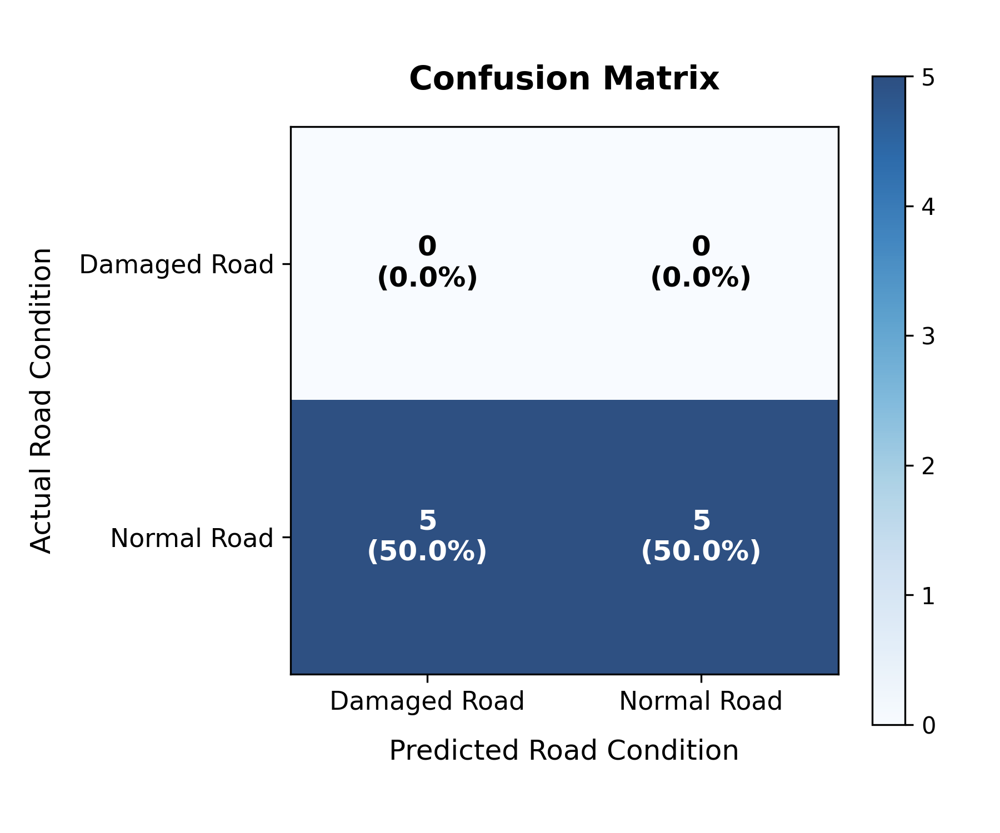

# AI-Based Road Damage Detection Using Deep Learning (CNN)


---

## 📌 1. Project Overview

Road infrastructure deteriorates over time due to weather fluctuations, heavy traffic loading, and structural material aging. Identifying defects like potholes and cracks early is crucial for traffic safety and road maintenance.

This college mini project presents an end-to-end image classification system that categorizes road surface photos into two distinct classes:
- **Normal Road**: Intact, undamaged pavement with uniform road surface.
- **Damaged Road**: Pavements exhibiting structural defects such as longitudinal cracks, transverse cracks, alligator cracking, or potholes.

The system combines a custom Convolutional Neural Network (CNN) built with **TensorFlow / Keras** and an interactive, user-friendly frontend built using **Streamlit**.

---

## 📑 2. Abstract

Manual visual inspection of roadway networks is labor-intensive, hazardous, subjective, and costly. This project implements a lightweight deep learning classification pipeline based on Convolutional Neural Networks (CNNs). By preprocessing road imagery, extracting Pascal VOC XML annotations from the **Road Damage Dataset 2022 (RDD2022)**, and training a 3-block convolutional network, the system automates binary road condition assessment. The trained model achieves fast inference times and is deployed via a Streamlit web application where municipal engineers and college evaluators can upload road photos to receive real-time classification results and confidence ratings.

---

## ⚠️ 3. Problem Statement

Transportation agencies worldwide struggle with reactive maintenance where road hazards like potholes and alligator cracks are addressed only after citizen complaints or vehicle damage occurs. Existing inspection methods rely either on expensive specialized survey vehicles equipped with laser profilometers or manual on-foot inspection teams. There is a strong need for an accessible, computer-vision-based classification system capable of screening road imagery taken from smartphones or dashboard cameras.

---

## 🎯 4. Objectives

1. Develop a clean, modular, and beginner-friendly binary image classifier using **TensorFlow and Keras**.
2. Automate dataset parsing for the **RDD2022 dataset**, converting Pascal VOC XML damage annotations into clean **Normal** and **Damaged** image categories.
3. Standardize and preprocess image data (128 × 128 resolution, RGB color space, normalized $[0, 1]$ floating-point values).
4. Evaluate model performance using standard metrics: Accuracy, Loss, Precision, Recall, F1-Score, and Confusion Matrix.
5. Provide a standalone command-line prediction interface (`predict.py`) and an interactive **Streamlit** web application (`app.py`).

---

## 🔄 5. Existing System vs. Proposed System

| Parameter | Existing System | Proposed Deep Learning System |
| :--- | :--- | :--- |
| **Inspection Methodology** | Manual walking or high-cost sensor vans | Automated vision-based inference via CNN |
| **Speed** | Slow, takes days/weeks to inspect a sector | Instantaneous (< 100 milliseconds per photo) |
| **Cost** | High labor and equipment expenditures | Low cost; runs on standard hardware / CPU / GPU |
| **Safety** | High risk to road survey personnel in traffic | Safe, camera-based data collection |
| **Reproducibility** | Subjective, observer-dependent bias | Deterministic, reproducible model weights |

---

## 🏗️ 6. System Architecture

The following diagram illustrates the complete end-to-end processing pipeline:

```
+---------------------+        +-------------------------+
|  Raw Road Images    |        | Pascal VOC Annotations  |
| (data/raw/images/)  |        | (data/raw/annotations/) |
+----------+----------+        +------------+------------+
           |                                |
           +----------------+---------------+
                            |
                            v
               +---------------------------+
               |       preprocess.py       |
               | - Parse XML objects       |
               | - Filter missing/corrupt  |
               | - Resize to 128x128 (RGB) |
               +-------------+-------------+
                             |
             +---------------+---------------+
             |                               |
             v                               v
    data/processed/Normal/          data/processed/Damaged/
             |                               |
             +---------------+---------------+
                             |
                             v
               +---------------------------+
               |       train_model.py      |
               | - 80% Train / 20% Val     |
               | - Rescaling (1./255)      |
               | - 3 x Conv2D + MaxPool2D  |
               | - Dense(128) + Dropout    |
               | - Dense(1, Sigmoid)       |
               +-------------+-------------+
                             |
                             v
               +---------------------------+
               | models/road_damage_model  |
               +-------------+-------------+
                             |
             +---------------+---------------+
             |                               |
             v                               v
    evaluate_model.py                     app.py (Streamlit)
    - Confusion Matrix                   - Upload Road Photo
    - Accuracy & Loss Curves             - Predict Normal/Damaged
    - Precision, Recall, F1              - Confidence Percentage
```

### CNN Layer Architecture Details

| Layer Index | Layer Type | Output Shape | Parameters | Function / Purpose |
| :--- | :--- | :--- | :--- | :--- |
| **Input** | InputLayer | `(None, 128, 128, 3)` | 0 | Receives RGB color images of dimension 128×128 |
| **1** | Rescaling | `(None, 128, 128, 3)` | 0 | Scales pixel values from $[0, 255]$ to $[0.0, 1.0]$ |
| **2** | Conv2D (32, 3×3) | `(None, 126, 126, 32)` | 896 | Detects low-level edge and corner features with ReLU |
| **3** | MaxPooling2D (2×2) | `(None, 63, 63, 32)` | 0 | Downsamples spatial resolution by half |
| **4** | Conv2D (64, 3×3) | `(None, 61, 61, 64)` | 18,496 | Detects road crack contours and texture variations |
| **5** | MaxPooling2D (2×2) | `(None, 30, 30, 64)` | 0 | Downsamples spatial dimensions to 30×30 |
| **6** | Conv2D (128, 3×3) | `(None, 28, 28, 128)` | 73,856 | Learns complex pothole edges and alligator crack shapes |
| **7** | MaxPooling2D (2×2) | `(None, 14, 14, 128)` | 0 | Downsamples spatial dimensions to 14×14 |
| **8** | Flatten | `(None, 25088)` | 0 | Unrolls 3D feature representations into a 1D vector |
| **9** | Dense (128, ReLU) | `(None, 128)` | 3,211,392 | Fully connected decision layer combining learned features |
| **10** | Dropout (0.5) | `(None, 128)` | 0 | Randomly drops 50% connections during training to avoid overfitting |
| **Output** | Dense (1, Sigmoid) | `(None, 1)` | 129 | Outputs continuous classification probability $[0.0, 1.0]$ |

- **Total Parameters**: 3,304,769 (~12.6 MB)
- **Loss Function**: Binary Crossentropy
- **Optimizer**: Adam
- **Metric**: Accuracy

---

## 💻 7. Technologies Used

- **Language**: Python 3.10+
- **Deep Learning Framework**: TensorFlow & Keras
- **Scientific Computing**: NumPy
- **Image Processing**: Pillow (PIL)
- **Model Evaluation**: Scikit-Learn
- **Visualization & Plotting**: Matplotlib
- **Web Application Framework**: Streamlit
- **Version Control**: Git & GitHub

---

## 📁 8. Project Folder Structure

```
Road-Damage-Detection/
│
├── app.py                     # Interactive Streamlit web frontend
├── train_model.py             # CNN model training and checkpointing script
├── preprocess.py              # XML annotation parser and image resizer
├── evaluate_model.py          # Generates accuracy/loss graphs, CM, and metrics
├── predict.py                 # Command-line single-image inference tool
├── generate_test_dataset.py   # Built-in sample generator for immediate testing
├── requirements.txt           # Python library dependencies
├── README.md                  # Comprehensive project documentation
├── .gitignore                 # Excludes raw images, venv, and cache files
│
├── models/
│   ├── .gitkeep
│   └── road_damage_model.keras # Saved trained CNN model
│
├── data/
│   ├── raw/
│   │   ├── images/            # Original road photos (.jpg, .png)
│   │   └── annotations/       # Pascal VOC XML files (.xml)
│   └── processed/
│       ├── Normal/            # Clean 128x128 images of undamaged roads
│       └── Damaged/           # Clean 128x128 images of damaged roads
│
├── results/
│   ├── .gitkeep
│   ├── accuracy_plot.png      # Training vs validation accuracy curve
│   ├── loss_plot.png          # Training vs validation loss curve
│   ├── confusion_matrix.png   # Annotated confusion matrix heatmap
│   ├── history.json           # Epoch-by-epoch loss and accuracy log
│   └── evaluation_metrics.json# JSON summary of actual model metrics
│
└── screenshots/
    ├── .gitkeep
    └── app_preview.png        # Screenshot of the Streamlit application
```

---

## 📊 9. Dataset Information (RDD2022)

The project is structured around the **Road Damage Dataset 2022 (RDD2022)**:
- **Official Repository**: [GitHub: sekilab/RoadDamageDetector](https://github.com/sekilab/RoadDamageDetector)
- **Dataset DOI**: [https://doi.org/10.6084/m9.figshare.21431547.v1](https://doi.org/10.6084/m9.figshare.21431547.v1)

### Damage Taxonomy in RDD2022:
- **D00 / D10**: Longitudinal Cracks (wheel tracking or joint separation)
- **D20**: Alligator Cracks (fatigue surface distress)
- **D40 / D43 / D44**: Potholes, rutting, bumps, and surface separation

### Labeling Rules Enforced by `preprocess.py`:
- If an XML file has one or more damage objects (`D00`, `D10`, `D20`, `D40`), the image is assigned to **`data/processed/Damaged/`**.
- If an XML file exists and explicitly contains **0 objects**, the image is assigned to **`data/processed/Normal/`**.
- If an image has **missing or corrupt XML**, it is **skipped** (missing annotations are never assumed to be normal road).
- Dedicated verified normal road images can also be dropped into `data/raw/normal_images/`.

---

## 🚀 10. Step-by-Step Installation & Execution Guide

### Step 1: Clone the Repository & Open Project Directory
```bash
git clone https://github.com/<your-username>/Road-Damage-Detection.git
cd Road-Damage-Detection
```

### Step 2: Set Up Virtual Environment (Recommended)
```bash
# On Windows
python -m venv .venv
.venv\Scripts\activate

# On Linux / macOS
python3 -m venv .venv
source .venv/bin/activate
```

### Step 3: Install Required Dependencies
```bash
pip install -r requirements.txt
```

---

### Step 4: Dataset Setup Options

You can run the project in one of two modes:

#### Option A: Quick Test Mode (Using Built-in Sample Generator)
To immediately verify the pipeline without downloading large dataset files:
```bash
python generate_test_dataset.py
```
This generates 50 sample road images (25 damaged with crack/pothole contours and 25 normal road textures) with matching Pascal VOC XML annotations.

#### Option B: Full RDD2022 Dataset Mode
1. Download a country subset from [RDD2022 Figshare](https://doi.org/10.6084/m9.figshare.21431547.v1) (e.g., Japan, India, or United_States).
2. Extract image files (`.jpg`) into `data/raw/images/`.
3. Extract Pascal VOC XML files (`.xml`) into `data/raw/annotations/`.
4. (Optional) Place any additional photos of clean, unblemished roads into `data/raw/normal_images/`.

---

### Step 5: Preprocess the Dataset
```bash
python preprocess.py
```
This filters out corrupted files, resizes all valid road images to 128 × 128 RGB, and populates `data/processed/Normal/` and `data/processed/Damaged/`.

---

### Step 6: Train the CNN Model
```bash
python train_model.py
```
This trains the CNN for 10 epochs using an 80% training / 20% validation split, displays layer-by-layer parameter summaries, and saves the trained model to `models/road_damage_model.keras`.

---

### Step 7: Evaluate the Model & Generate Graphs
```bash
python evaluate_model.py
```
This computes the actual performance metrics on the validation dataset and exports:
- `results/accuracy_plot.png`
- `results/loss_plot.png`
- `results/confusion_matrix.png`
- `results/evaluation_metrics.json`

---

### Step 8: Run Single Image Inference (CLI)
```bash
python predict.py data/processed/Damaged/sample_damaged_001.jpg
```
**Example CLI Output:**
```
======================================================================
 AI-BASED ROAD DAMAGE DETECTION - INFERENCE
======================================================================
 Image File  : data/processed/Damaged/sample_damaged_001.jpg
 Prediction  : DAMAGED ROAD
 Confidence  : 65.15%
======================================================================
```

---

### Step 9: Launch the Streamlit Web Application
```bash
streamlit run app.py
```
Open your web browser and navigate to `http://localhost:8501`.

---

## 📸 11. Screenshots & Sample Output

### Model Evaluation Visualizations
| Training vs. Validation Accuracy | Training vs. Validation Loss |
| :---: | :---: |
|  |  |

### Confusion Matrix
<p align="center">
  
</p>

---

## 🔮 12. Future Enhancements

1. **Multi-Class Damage Localization**: Transition from binary classification to object detection using YOLOv8 or Faster R-CNN to bound specific crack boundaries.
2. **GPS Geotagging**: Capture camera EXIF GPS coordinates to automatically plot detected potholes on Google Maps.
3. **Edge Deployment**: Quantize model to TensorFlow Lite (TFLite) for execution on Raspberry Pi 5 or mobile devices mounted on vehicle dashboards.
4. **Data Augmentation**: Incorporate random flips, rotations, and contrast adjustments to improve model robustness under rainy and nighttime lighting conditions.

---

## ⚠️ 13. Limitations

- **Binary Classification Scope**: Classifies the presence of road distress, but does not measure the square-meter surface area or depth of a pothole.
- **Extreme Weather Artifacts**: Wet pavement reflections or snow cover can affect classification confidence.
- **Dataset Size Dependency**: Accuracy directly depends on having a balanced volume of verified undamaged road images alongside RDD2022 distress photos.

---

## 📚 14. References

1. Arya, D., Maeda, H., Ghosh, S. K., Toshniwal, D., Mraz, A., Kashiyama, T., & Sekimoto, Y. (2022). *Crowdsensing-based Road Damage Detection: Challenge and Datasets (RDD2022)*. arXiv:2209.08538.
2. Official RDD Repository: [https://github.com/sekilab/RoadDamageDetector](https://github.com/sekilab/RoadDamageDetector)
3. TensorFlow Documentation: [https://www.tensorflow.org/api_docs/python/tf/keras](https://www.tensorflow.org/api_docs/python/tf/keras)
4. Streamlit Documentation: [https://docs.streamlit.io](https://docs.streamlit.io)

---

## 👨‍💻 Author & Acknowledgements
- Developed by: Gaius Parasa ([@gaiusparasa10-hash](https://github.com/gaiusparasa10-hash))
- Purpose: College Mini Project in Deep Learning & Computer Vision.
